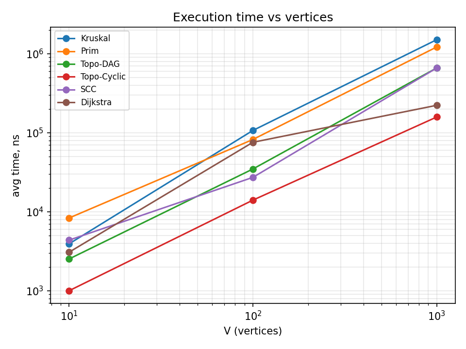
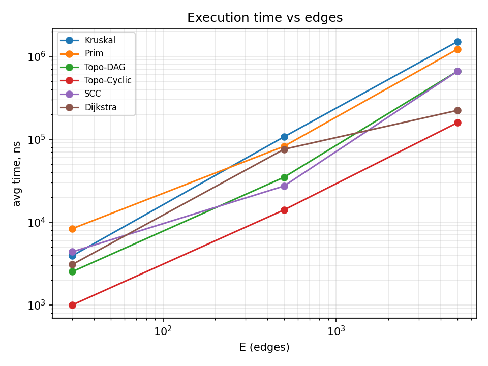
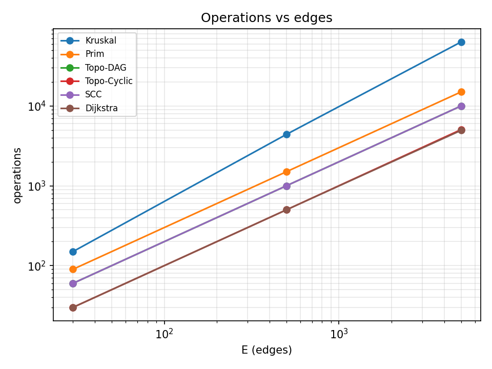
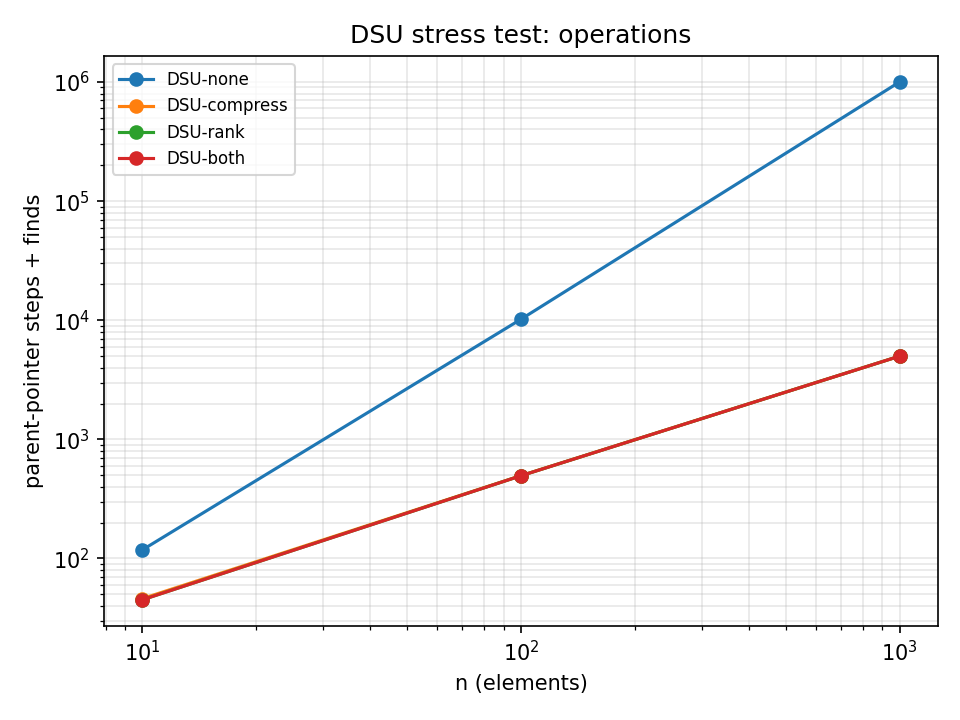

# Assignment 3 — Smart City Infrastructure and Route Planning

## 1. Overview
A city is a graph: vertices are districts, edges are roads, weights are costs or distances (random integers 1–100).
`Graph` stores an edge list (`edges`) and adjacency lists (`adj`).

Implemented: DSU, Kruskal, Prim, topological sort, SCC (Kosaraju), Dijkstra.

## 2. Implementation
- **DSU:** `find` with path compression, `union` by rank.
- **Kruskal:** sort edges, add an edge if `union` joins two different sets.
- **Prim:** binary heap (`PriorityQueue`), starts from vertex 0.
- **Topological sort:** Kahn's algorithm. If not all vertices are output, the graph has a cycle.
- **SCC:** Kosaraju (DFS, then DFS on the reversed graph).
- **Dijkstra:** binary heap. Unreachable vertices get `INF`. Negative weights are rejected.

## 3. Complexity Analysis
Assumptions: adjacency list, binary heap.

| Algorithm | Time | Space |
|---|---|---|
| DSU find / union | O(α(n)) amortized | O(n) |
| Kruskal | O(E log V) | O(V + E) |
| Prim | O(E log V) | O(V + E) |
| Topological sort | O(V + E) | O(V) |
| SCC | O(V + E) | O(V + E) |
| Dijkstra | O((V + E) log V) | O(V + E) |

- **DSU:** path compression makes trees flat, union by rank keeps trees short. Together each operation is almost constant.
- **Kruskal:** the sort of the edges dominates the time.
- **Prim:** every edge may be pushed into the heap.
- **Topological sort and SCC:** each vertex and edge is visited a constant number of times.
- **Dijkstra:** the heap is used once per relaxed edge.

**Why Dijkstra fails with negative weights:** it treats a vertex taken from the heap as final, but a negative edge can make the path shorter later. Example: 0→1 (2), 0→2 (3), 2→1 (−2). Dijkstra gives 2 for vertex 1, the real answer is 1.

## 4. Experimental Setup
- Graphs: Small V=10 E=30, Medium V=100 E=500, Large V=1000 E=5000.
- Fixed seed `Random(42)`.
- MST graph: undirected and connected (random spanning tree plus random edges).
- Directed graph: random edges, it contains cycles.
- DAG: edges go only forward in a random vertex order, so it has no cycles.
- 5 repeats, `System.nanoTime()`, average time. Each repeat runs the algorithm several times and divides the time, to reduce noise.
- Operations: Kruskal = sort comparisons + DSU work, Prim = edge checks + heap inserts, others = edge checks. Kruskal and Prim count different things.

## 5. Results
Average time (microseconds):

| Algorithm | Small | Medium | Large |
|---|---:|---:|---:|
| Kruskal | 3.9 | 106.8 | 1,503.0 |
| Prim | 8.3 | 82.0 | 1,215.1 |
| Topo-DAG | 2.5 | 34.7 | 659.2 |
| Topo-Cyclic | 1.0 | 14.0 | 157.9 |
| SCC | 4.4 | 27.2 | 658.6 |
| Dijkstra | 3.1 | 75.6 | 222.1 |

Operations:

| Algorithm | Small | Medium | Large |
|---|---:|---:|---:|
| Kruskal | 150 | 4,403 | 63,319 |
| Prim | 90 | 1,500 | 15,000 |
| Topo-DAG | 60 | 1,000 | 10,000 |
| Topo-Cyclic | 30 | 500 | 5,054 |
| SCC | 60 | 1,000 | 10,000 |
| Dijkstra | 30 | 500 | 4,946 |

DSU stress test (build a chain of n unions, then n finds), steps:

| Variant | n=10 | n=100 | n=1000 |
|---|---:|---:|---:|
| none | 118 | 10,198 | 1,001,998 |
| compression only | 46 | 496 | 4,996 |
| rank only | 45 | 495 | 4,995 |
| both | 45 | 495 | 4,995 |






## 6. Comparison and Discussion
- **Kruskal vs Prim:** same MST weight every time. Kruskal does more operations because of sorting. In time, Prim was faster on Medium and Large, Kruskal on Small.
- **DSU:** without optimizations the steps grow like n². With compression or rank they grow like n. This matches the theory.
- **Topo-DAG and SCC:** operations are exactly 2E, so work is linear in V + E.
- **Topo-Cyclic** is cheaper than Topo-DAG: vertices on cycles never get in-degree 0, so almost no edges are processed.
- **Dijkstra:** about E operations. On Large it is less than E (4,946) because edges of unreachable vertices are never checked.
- Times for small graphs are a few microseconds, so they are noisy (JVM warm-up). The operation counts are exact and match the theory.

## 7. Testing
`Tests.java`: 1230 checks, all pass.
- Single vertex, small graphs, disconnected graph, duplicate weights with several valid MSTs, known MST weight.
- 300 random graphs: Kruskal weight equals Prim weight, topological order is valid on every DAG, SCC is checked against a reachability matrix (each vertex is in exactly one component), Dijkstra is compared with Bellman-Ford.
- Cycle detection in topological sort, unreachable vertex (`INF`, empty path), negative weight rejected, DSU with all flag combinations.

## 8. Conclusion
- MST: Kruskal and Prim give the same cost, Kruskal is simple for edge lists, Prim is natural with adjacency lists.
- DSU needs both optimizations to be fast.
- Topological sort checks dependencies and finds cycles. SCC finds groups of mutually reachable districts. Both are linear.
- Dijkstra is for non-negative distances. For negative weights use Bellman-Ford.

## Structure and run
```
assignment-3/
├── src/ (graph, dsu, mst, connectivity, shortestpath, Tests.java, Benchmark.java)
├── results/ (tables, plots)
└── README.md
```
Run from the project root: `Tests`, then `Benchmark`.